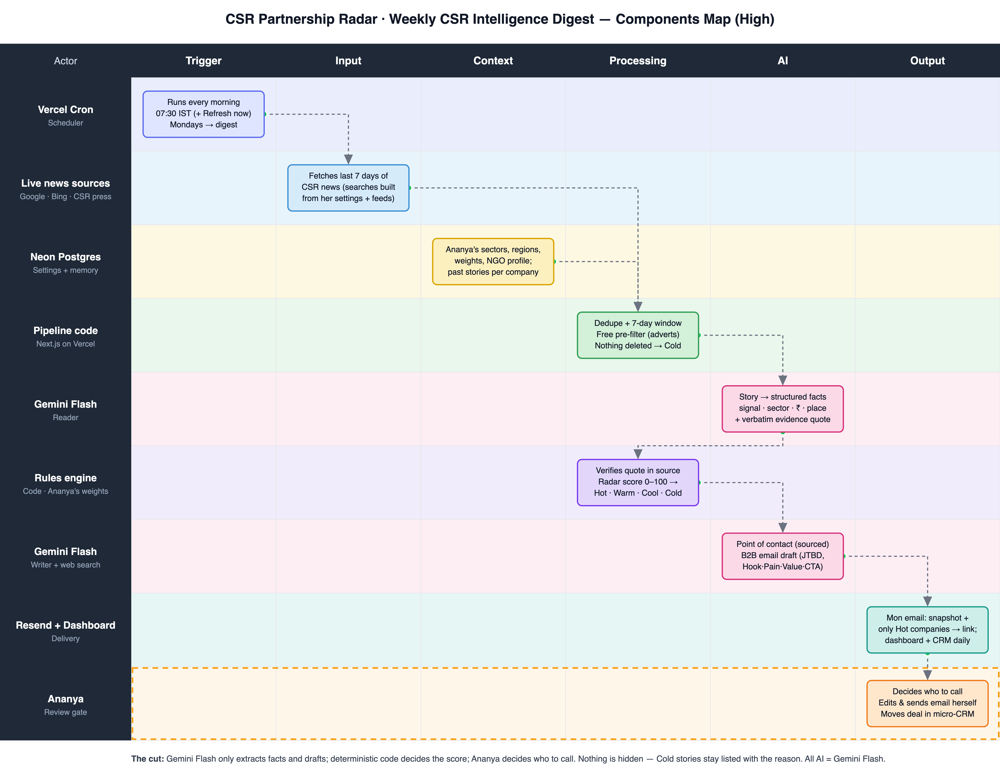

# CSR Partnership Radar

**Live:** https://csr-radar.vercel.app · **Login:** `Radar@2026` (shown on the login page for examiners)

Ananya heads corporate partnerships at a Pune NGO that runs skilling programmes for school dropouts and first-generation job seekers. Most of its money comes from corporate CSR, and timing is everything. She hears about roughly a third of relevant announcements. Last year she found a digital-skilling project three months after the company started looking for partners.

CSR Radar reads the last 7 days of Indian CSR news **every morning** and ranks every story against her sectors, regions and audience. Each story gets one decision: *is this worth a call this week?* On **Monday morning** she receives an email with a dashboard snapshot and only the companies that pass. Everything else is one click away on the dashboard, which also works as a micro-CRM for the deals that follow.

> **AI reads, code decides, Ananya chooses.** Gemini Flash turns news into facts with a verbatim quote. Deterministic code scores those facts with weights she owns. Nothing is hidden: stories below the bar stay listed as *Cold*, with the reason, because she may know someone there.



## How it follows the components map

| Map row | Where in the code |
|---|---|
| **Trigger**: daily 07:30 IST cron, Monday email, "Refresh now" | `vercel.json` (cron `0 2 * * *` UTC) → `src/app/api/cron/daily/route.ts`; `src/app/api/run/route.ts` runs in `after()`, and the UI polls `api/run/[id]` |
| **Input**: live external data | `src/lib/sources.ts`: Google News RSS (≈15 queries built from settings), Bing News RSS (plain-keyword queries from settings, publisher URLs), three CSR trade publications (India CSR, The CSR Journal, The CSR Universe), and Gemini + Google Search as gap-fill. Every AI-found headline is checked against Google News and dropped if no real article matches |
| **Context**: Ananya's configuration | `src/lib/settings.ts` (schema + defaults), `src/lib/settings-store.ts` (Neon), `/settings` page |
| **Processing**: clean, pre-filter, verify | `src/lib/text.ts` (canonical URLs, same-story clustering, 7-day window, quote verification); `prefilterReason` in `src/lib/pipeline.ts` |
| **AI**: Gemini Flash only | `src/lib/extract.ts` (batched structured extraction, JSON schema, temp 0; point of contact), `src/lib/outreach.ts` (B2B email method), `summarise()` in `pipeline.ts` |
| **Decision**: radar score → Hot / Warm / Cool / Cold / Policy | `src/lib/score.ts`. Deterministic and explainable; every point is shown on the story brief |
| **Output**: email, dashboard, brief, CRM, runs | `src/lib/email.ts` + `src/app/api/snapshot/route.tsx` (PNG via `next/og`); `src/app/(app)/*` pages; `src/lib/crm.ts` + `src/app/actions/crm.ts` |

## The pipeline (`src/lib/pipeline.ts`)

```
1 COLLECT    Google News · Bing News · CSR trade press · Gemini web search, in parallel; each can fail alone
2 CLEAN      7-day window → canonical URL dedupe → stored (re-runs never re-read a story)
3 PRE-FILTER free keyword check removes adverts and notices before any AI call (kept as Cold with the reason)
4 READ       Gemini Flash, 10 stories per call, 4 calls in parallel, JSON schema, temperature 0
5 VERIFY     the evidence quote must appear in the source text
6 SCORE      deterministic weights from Settings; same story from several outlets → one card
7 ENRICH     Hot stories: point of contact + outreach draft (on demand for any other story)
8 SUMMARISE  "the week in one minute", from the ranked facts only
9 DELIVER    Mondays: Resend email (snapshot + Hot companies only) → links back to the dashboard
```

Every stage writes its counts to `runs.stats`. The **Runs** page shows the funnel, each source's status and timing, errors and recoveries, tokens and cost.

## The radar score (`src/lib/score.ts`)

| Factor | Default points |
|---|---|
| Signal: seeking NGO partners / new initiative / more CSR money / other | 40 / 30 / 25 / 10 |
| In her sectors | 20 |
| Serves her audience (youth, first-generation, dropouts) | 10 |
| Region: Pune & PCMC / Maharashtra / pan-India / other state | 20 / 14 / 10 / 5 |
| Amount stated: ₹10 Cr+ / any | 10 / 5 |
| Freshness (≤ 2 days, tapering to 0 at 7) | up to 10 |
| Company warming (signalled before in 90 days) | 5 |
| Project already completed / quote not verified / headline only | −12 / −10 / −5 |

**Hot** ≥ 62 · **Warm** ≥ 42 · **Cool**: in her sectors, below 42 · **Cold**: off-sector or not corporate CSR, still listed · **Policy**: always shown.
**Override:** a verified, explicit search for NGO partners in her sectors is always Hot. That is the exact moment she missed last year.
All weights and thresholds are editable in Settings.

## Outreach drafts (`src/lib/outreach.ts`)

Each draft follows a B2B method; the buying signal is the story itself.

1. **Buyer-journey stage**, set by code from the signal: partner search → *decision*; new initiative → *consideration*; more money → *awareness*; completed → *post-purchase*.
2. **Gemini fills each step**: research facts, the verified trigger, buyer **facts vs assumptions**, the job to be done (job, problem, outcome — all marked as hypotheses), the angle, then **Hook → Pain → Value → CTA**, a self-check and a follow-up with a new angle.
3. **Non-negotiable rule, enforced in code**: any number in the email that does not appear in the story or in her NGO profile is flagged (`inventedNumbers`). Proof points come only from Settings.
4. Ananya edits and sends it herself. Nothing is ever sent automatically.

## Point of contact

The contact is either the spokesperson named in the story, or the CSR head found by Gemini + Google Search. A web-search contact is kept only if it comes with a source link. The system **never** guesses emails or phone numbers. It provides LinkedIn and CSR-committee search links, and she adds verified contacts in the CRM.

## Micro-CRM

- **Company profiles**: every signal over time, contacts (found and her own), a warm-intro field, deal value, next step with due date, notes, and an activity log.
- **Pipeline board**: On radar → Researching → Contacted → Meeting → Proposal → Won / Lost / Parked.
- **Next steps due this week** appear on the dashboard.

## Evidence that it works

- **Live data**: the deployed site shows the current week's real stories, refreshed every morning.
- **Unit tests**: `npm test` runs 26 tests covering scoring rules, the override, penalties, geography tiers, dedupe, window, URL canonicalisation, quote verification, the Google News and Bing parsers, query building, the pre-filter, the invented-number guard and journey stages.
- **Extraction eval**: `npm run eval` compares a fresh Gemini read with 36 real headlines labelled by hand. Results are in [`eval/results.md`](eval/results.md): **86% 4-class accuracy, opportunity recall 6/7**, up from 78% and 2/7 after one prompt iteration (both versions recorded).
- **Run log**: the Runs page, for every run in production.
- **CI**: GitHub Actions runs lint, type-check, tests and a production build on every push (`.github/workflows/ci.yml`).
- **In-app explainer**: the *How it works* page shows the components map, the nine stages and live run numbers.

## Trade-offs we chose

| Decision | Why | Cost |
|---|---|---|
| LLM extracts, code scores | Reproducible, testable and explainable; Ananya tunes weights, not prompts | Less nuance than an LLM judging "warmth" directly |
| Feeds first, LLM search second | Cheap, citable, no invented stories; grounded search only fills gaps and is verified | Coverage depends on what news indexes carry |
| Nothing is dropped | Her relationships can turn a Cold story Hot; a false negative is the costliest error | A longer Cold list (collapsed by default) |
| Cheap pre-filter before Gemini | Saves cost and latency; logged per run | A keyword rule can be wrong, so filtered stories are still listed |
| Batched extraction, cached per story | ~10× fewer calls; re-runs and daily refreshes only pay for new stories | One bad batch affects 10 stories (logged, retried next run) |
| Source isolation | One failing source never blocks the digest; a search-quota hit is marked *skipped* and retried next run | Some runs have fewer sources (shown on Runs) |
| Dropped GDELT for Bing News | GDELT rate-limits shared serverless IPs (HTTP 429 on every Vercel run); Bing News RSS is keyless and reliable | Bing's RSS needs plain keyword queries, so it has its own query builder |
| Snapshot via `next/og` instead of a headless browser | Fast and reliable on Vercel; a signed URL loads in Gmail | It is a rendered summary of the dashboard, not a pixel screenshot |
| One shared password | Simple for a small team | No per-user audit trail |

## Run it

```bash
cp .env.example .env.local   # Neon, Gemini, Resend, password, cron secret
npm install
npm run db:migrate
npm run pipeline             # one full run from the terminal (add -- --email to send)
npm run dev                  # http://localhost:3000
npm test                     # 26 unit tests
npm run eval                 # extraction accuracy vs labelled headlines
```

**Stack:** Next.js 16 · TypeScript · zod · Gemini Flash (`@google/genai`; every AI task, no other model) · Neon Postgres + Drizzle · Resend · Vercel (hosting + Cron) · GitHub.

Built for MESA Cohort 4, AI Final Evaluation, Problem Statement 9 (High difficulty).
